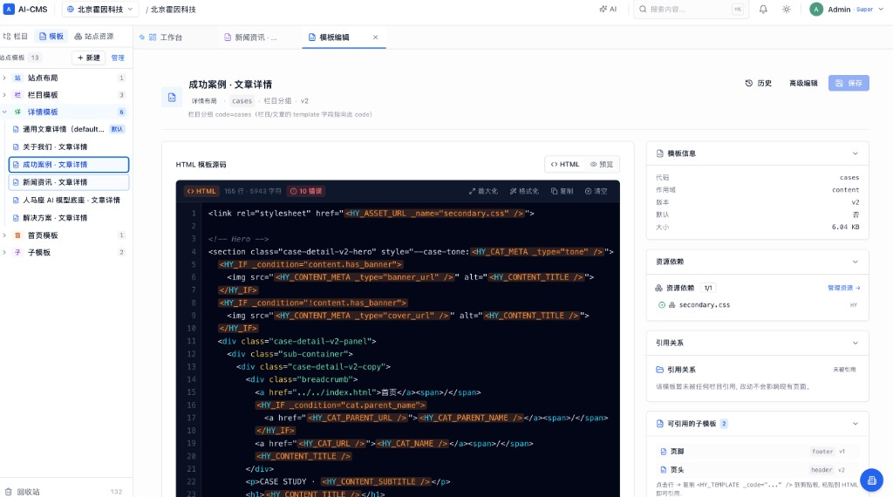
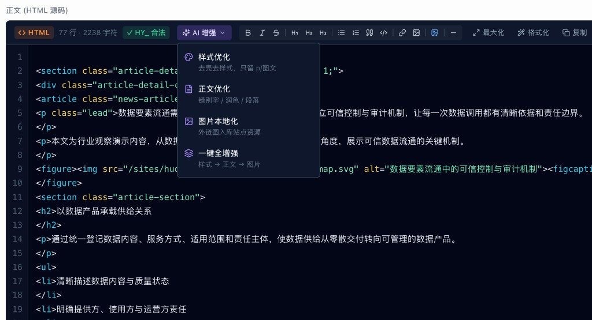
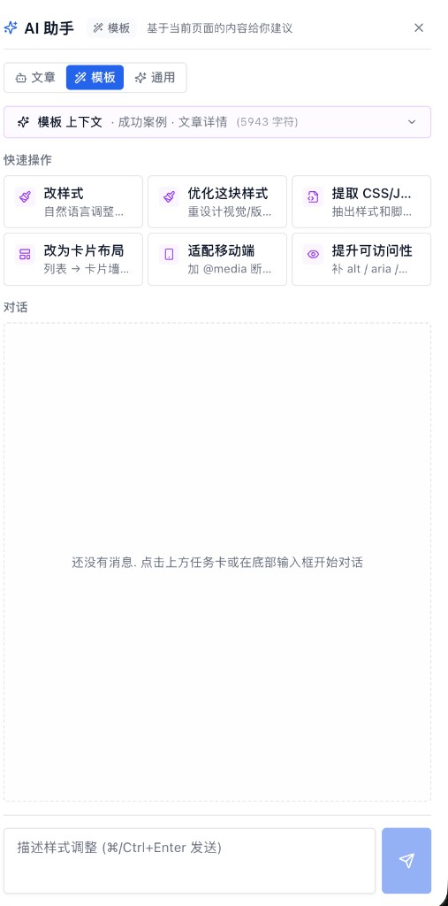
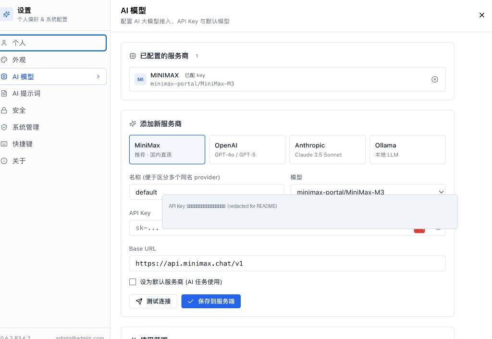

# AI-CMS 产品使用手册（按界面功能全量）

> 依据后台 **真实页面与按钮** 整理。读者：无开发经验、具备基础 HTML。  
> 配套：《HY 标签使用手册》。生成日期：2026-08-24。  
> **原则**：每个可见入口都应对应到下面某一节；操作按「在哪点、填什么、结果是什么」写清。

---

## 0. 怎么用这份手册

1. 先看 **第 1 章功能总表**，用「界面」找到功能。  
2. 再打开对应章节按步骤做。  
3. 模板占位符不在本章展开，见标签手册。

**安全约定**：不要把 API Key、密码写进模板或发给无关的人。截图前遮住密钥。

---

## 1. 按界面的功能总表（对照前端）

### 1.1 未登录可访问的页面

| 页面路径 | 界面标题/作用 | 你能做的操作 |
|---|---|---|
| `/login` | 登录 | 邮箱+密码登录；去注册；忘记密码 |
| `/login/2fa` | 两步验证 | 输入验证码完成登录 |
| `/register` | 注册 | 创建账号（若环境开放注册） |
| `/forgot-password` | 忘记密码 | 填邮箱收重置信 |
| `/reset-password` | 重置密码 | 用邮件链接设置新密码 |
| `/invitations/accept` | 接受邀请 | 登录后加入站点 |

### 1.2 工作台 AppLayout（`/dashboard` 等）

侧栏可见：**概览、模板、发布、媒体库**；另有 **AI Providers、AI 运行历史**；超管另有 **用户管理、角色管理、权限管理、回收站**。顶栏：**搜索、通知铃、主题、用户菜单**。

| 路径 | 页面 | 主要操作 |
|---|---|---|
| `/dashboard` | 概览 | 看数字（站点/文章/待审/发布）；拖拽卡片排序；全部站点网格：搜索/筛选/新建/编辑/删除/域名/批量发布删除；快捷入口写文章/媒体/主题/发布 |
| `/layouts` | 模板管理 | 按 scope 目录筛选；搜索；导入 ZIP；设默认/启用停用；批量删除；打开编辑；版本历史回滚 |
| `/publish` | 发布 | 选站点；全站发布；看任务列表；失败看日志；对成功记录 **回滚** |
| `/themes` | 主题 | 选主题库；改 design tokens；保存为新版本；版本历史 **回滚** |
| `/search` | 全局搜索结果 | 搜站点/栏目/文章（也可用顶栏 ⌘/Ctrl+K） |
| `/notifications` | 我的消息 | 筛选全部/未读/成功/失败；标已读；删除；清空 |
| `/ai/providers` | AI 服务商（独立页） | 与设置里「AI 模型」同类能力 |
| `/ai/runs` | AI 运行历史 | 查看每次任务状态、用量 |
| `/users` | 用户管理（超管） | 列表/创建/禁用等 |
| `/roles` | 角色管理（超管） | 新建角色、勾选权限点 |
| `/permissions` | 权限管理（超管） | 查看权限点 |
| `/recycle-bin` | 平台回收站（超管） | 站点级删除后的恢复入口之一 |

### 1.3 内容工作区 ContentLayout（主入口 `/`）

顶栏：Logo、**站点切换器**、搜索、AI、铃铛、主题、用户。左侧三 Tab：**栏目 / 模板 / 站点资源**。中间：多标签 + 工作区。右下：**AI 助手**。

| 界面 | 功能列表 |
|---|---|
| 站点切换下拉 | 最近访问/全部站点；**模板管理、媒体库、站点资源、发布站点、预览站点、发布日志**；管理所有站点（回概览） |
| 栏目树 | 搜索栏目；**新建栏目**（顶级）；**导入 Excel**；节点旁「+」建子栏目；可把栏目拖到根作顶级；右键：新建顶级/子栏目、栏目下新建文章、编辑、复制栏目结构、删除栏目及子栏目 |
| `/contents` | 站点级内容列表（健康度等入口会跳到这里），筛选与栏目页类似 |
| 模板树 | 分组：站点布局/栏目模板/详情模板/首页/子模板；点条目打开模板编辑 |
| 站点资源树 | CSS/JS/图片等目录；打开完整资源页 |
| `/c/:栏目ID` | 栏目内容页：设置/发布本栏目/**新建文章**/列表批量，见第 5 章 |
| `/sites/:id/contents/:id` | 文章编辑，见第 6 章 |
| `/sites/:id/layouts/:id` | 模板源码编辑，见第 8 章 |
| `/sites/:id/media` | 媒体库，见第 7 章 |
| `/sites/:id/assets` | 站点资源页，见第 7 章 |
| `/sites/:id/deploy-log` | 本站发布日志 |
| `/sites/:id/recycle` | **站点回收站**：文章/栏目/模板/媒体，还原或永久删除 |

---



## 2. 登录、注册、密码、2FA

### 2.1 登录

1. 打开后台（本地常见 `http://localhost/admin`，经 Nginx 时也是 `/admin`）。  
2. 输入邮箱、密码，登录。  
3. 若账号开启 2FA，会跳到 `/login/2fa`，输入验证器数字。  

演示环境常见账号：`admin@admin.com`（密码以部署说明为准，登录后立刻改掉）。

### 2.2 忘记密码 / 重置

1. 登录页点「忘记密码」，填邮箱。  
2. 打开邮件中的链接进入「重置密码」，设新密码再登录。  
3. 若收不到信：检查垃圾箱，或请超管重置（依赖服务器是否配置发信）。

### 2.3 注册与邀请

- 开放注册时走 `/register`。  
- 被邀请：打开邀请链接 → 登录或注册 → 自动成为该站成员。

---

## 3. 顶栏与用户菜单（每个按钮）

| 控件 | 操作 |
|---|---|
| 站点切换 | 换当前站；展开「当前站点功能」见 1.3 |
| 搜索框 | ⌘/Ctrl+K，搜标题/名称 |
| AI | 打开助手（文章/模板/通用） |
| 铃铛 | 未读数量角标；抽屉里看发布成功失败；点进「我的消息」 |
| 主题 | 浅色 / 深色 / 跟随系统（**只改后台皮肤**） |
| 用户菜单 | 个人资料、设置、登出 |
| 工作区多标签 | 同时打开多篇文章/模板；点标签切换；关标签不删数据 |

设置弹窗页签：**个人、外观、AI 模型、AI 提示词、安全（2FA）、系统管理（超管）、快捷键、关于**。

### 3.1 全局搜索 `/search`

1. 点顶栏搜索框，或按 **⌘/Ctrl+K**，或按 **/** 聚焦搜索框。  
2. 输入关键词后进入搜索结果页（约 250ms 防抖）。  
3. 结果按站点分组，点一条打开对应文章/栏目。  
4. 可搜标题等全文（后端高亮匹配片段）。

### 3.2 安全（2FA）

设置 → **安全**：按页面提示绑定验证器 App，之后登录会多一步 `/login/2fa`。丢失验证器需超管协助，生产环境务必先备份恢复码（若界面提供）。

---

## 4. 站点（概览里的「全部站点」）

入口：工作台 **概览** 下方「管理全部站点」卡片网格（站点切换里「管理所有站点」也会过来）。

**你能做的：**

| 操作 | 怎么做 | 结果 |
|---|---|---|
| 搜索/排序/筛选 | 顶部搜索与筛选 | 缩小站点列表 |
| 新建站点 | 「新建站点」 | 见 4.1 |
| 进入内容 | 点站点卡片进工作区 | 左树出现该站栏目 |
| 编辑站点 | 卡片菜单「编辑站点」 | 见 4.2 |
| 域名 | 「绑定域名」/「N 个域名」 | 见 4.3 |
| 发布 | 卡片「发布」 | 全站静态构建入队，铃铛通知结果 |
| 删除 | 「删除」 | 进回收站，可还原 |
| 批量删除 | 多选 + 批量删除 | 同样进回收站 |
| 重名警告 | 系统提示 | 同名站在切换器里可能只显示一个，完整列表在概览 |

**发布站点（另一入口）**：站点切换 → **发布站点** → 确认对话框 → 入队。完成后可 **预览站点**（新窗口打开 `/sites/站点slug/`）。未发布成功时预览可能空白或 404。

### 4.1 新建站点（逐步）

1. 概览「全部站点」点 **「新建站点」**。  
2. 填 **Slug**（必填，自动转成小写字母/数字/连字符，如 `my-blog`）。  
3. 填 **名称**（必填，给人看）。  
4. 可选填 **描述**。  
5. 提交。系统会尝试自动建一个根栏目，名称「默认栏目」、slug `default`。  
6. 成功后进入该栏目页，可再改名或用 Excel 导入真正的栏目树。根栏目创建失败时站点仍在，需在左树手动 **新建栏目**。

### 4.2 编辑站点

卡片菜单 **「编辑站点」**。左侧改：站点名称、描述（最多 500 字）、Slug、封面图 URL（须 `http://` 或 `https://`）。右侧是列表卡片的实时预览。有改动时标题旁显示「N 项改动」，点保存才写入。改 slug 会影响已发布路径，请谨慎。

口号、关键词、备案号、版权等若站点设置里还有独立字段，以当前对话框为准；它们会进入 `HY_SITE_*` 标签。

### 4.3 域名管理

1. 卡片上点 **「绑定域名」** 或 **「N 个域名」**。  
2. 输入如 `example.com` / `www.example.com`，类型选 **主域名** 或其他（以选项为准）。  
3. 已绑定列表可改类型或删除。  
4. DNS 解析到本机/服务器后，访客才能用该域名打开静态站（还须 Nginx/部署侧配置，本手册不写运维）。

---

## 5. 栏目（左树 + 栏目页 + Excel）

### 5.1 左树按钮

| 按钮 | 作用 |
|---|---|
| 新建栏目 | 打开「新建栏目」对话框（顶级栏目） |
| **导入 Excel** | 打开「从 Excel 导入栏目」 |

**右键菜单：**

- 新建顶级栏目 / 新建子栏目  
- 在栏目下新建文章  
- 编辑（同栏目设置）  
- 复制栏目结构  
- 删除栏目及子栏目  

### 5.2 新建栏目要填的字段（CreateCategoryDialog）

| 字段 | 必填 | 说明 |
|---|---|---|
| 名称 | 是 | 菜单上显示的名字 |
| 发布目录名 slug | 是 | URL 一段；默认由名称转拼音，可手改；手改后不再跟名称变 |
| 栏目模板 | 是 | 该栏目**列表页**用哪套 layout（scope=category） |
| 详情模板 | 是 | 该栏目下**文章页**用哪套 layout（scope=content） |

父栏目：从右键「新建子栏目」进入时自动带上父级。

### 5.3 从 Excel 导入栏目（完整步骤）

**入口**：栏目树顶部 **「导入 Excel」**。

**文件要求：**

- 仅 **`.xlsx`**（不是 .xls）  
- 最大 **5 MB**  
- 表头三列名称：**一级栏目 / 二级栏目 / 三级栏目**（按列名识别）  
- **空单元格继承上一行** 的上一级  

**示例（与对话框内说明一致）：**

```
一级栏目      二级栏目              三级栏目
产品中心      海石 AI 标签平台
              海山中台平台
              泰坦可信空间
产品解决方案    可信数据空间
              数据安全治理
```

**操作步骤：**

1. 点「导入 Excel」。  
2. 点击或拖入 xlsx（对话框会显示文件名与大小）。  
3. 点 **「上传并导入」**。等待「解析并创建栏目中…」（真正解析在服务器，浏览器不预览表格内容）。  
4. 成功后显示 **已导入 N 个栏目**，并列出前 20 个名称。  
5. 关闭对话框，左树刷新。再给每个栏目进 **栏目设置** 绑定正确的列表/详情模板（导入通常只建树，模板可能是默认值）。  

失败：看红字提示（格式不对、未登录权限、站点未选等）。

### 5.4 新建文章（完整步骤）

**真正会立刻在数据库里建一篇稿的，只有栏目内容页右上角的「新建文章」。**

| 入口 | 点了之后发生什么 |
|---|---|
| 栏目页右上角 **「新建文章」** | 立刻创建一篇稿，标题为「未命名文章」，slug 形如 `untitled-xxxx`，所属栏目=当前栏目，然后打开文章编辑页 |
| 左树右键 **「在栏目下新建文章」** | **不会直接创建**。只跳到该栏目页，并提示：请点右上角「新建文章」 |
| 概览页顶栏 **「新建文章」** | 进入内容工作区（需再选栏目，用栏目页按钮真正创建） |
| 栏目树节点旁 **「+」** | 那是 **新建子栏目**，不是新建文章 |

**逐步操作：**

1. 顶栏切到目标站点。  
2. 左侧点进目标栏目（中间出现该栏目的文章列表）。  
3. 点右上角 **「新建文章」**（按钮会短暂显示「创建中…」）。  
4. 进入编辑页：标题框是「未命名文章」；发布路径是自动占位 slug。  
5. 改标题。在这篇**新稿、且你还没手改过 slug** 时，slug 会跟着标题变成拼音/英文短横线。一旦你手动改过路径，标题再变也不会自动改 slug。已有旧文章 **不会** 因改标题而改路径。  
6. 在 HTML 区写正文（或导入 HTML），按需填右侧：栏目副本、头条、封面、Banner、摘要、状态。  
7. **保存**（⌘/Ctrl+S）。此时一般是草稿，访客网站上看不到。  
8. 点 **发布** 或 **保存并发布**，再等静态生成（铃铛会提示）。  

空栏目时列表区会写：点击右上角「新建文章」开始。无写权限时按钮不可用。

建好后的每一个按钮见第 6 章。

### 5.5 栏目内容页 `/c/:id`（每个控件）

**标题行：**

- 栏目名、共 N 篇  
- 布局徽章：默认列表 / 新闻资讯  
- **栏目设置**：名称、slug、描述、页面布局（默认列表 / 新闻资讯等）  
- **发布本栏目**：只重建该栏目静态页  
- **新建文章**：创建「未命名文章」并打开编辑页  

**新闻资讯模式**：提示下属文章需要 **封面图** 才能在卡片上展示完整。

**Tab：** 内容列表 / 模板 / 媒体库（后两个切到对应能力）。

**内容列表工具：**

- 搜索标题/slug  
- 状态过滤：全部、草稿、待审、已发布、计划、归档  
- 全选当前页  
- 行上可标 **头条**  
- 单篇：打开发布、取消发布、删除（进回收站）  

**批量（勾选后底栏）：** 批量发布、批量归档、批量移栏目、批量删除。

**栏目设置里的 slug**：可预览；「已从名称自动转全拼」或「手动改过不再随名称变化」。

---

## 6. 文章编辑页（每个按钮与右侧栏）

路径：`/sites/{站点ID}/contents/{文章ID}`。



### 6.1 顶栏

| 控件 | 作用 |
|---|---|
| 返回 | 回所属栏目列表 |
| 标题输入 | 改标题；未保存显示「未保存」 |
| 站点名链接 | 回站点内容 |
| 路径 code | 如 `/栏目目录/文章slug.html` |
| 状态徽章 | 草稿/待审/已发布… |
| 「副本」徽章 | 多栏目复制出来的稿，改主稿不同步 |
| **导入 HTML** | 本地 html 或网络 URL，解析 CSS 写入正文；已有正文会确认覆盖 |
| **新窗预览** | 实时渲染（带登录，勿公开转发链接） |
| **线上页** | 已生成静态 HTML 时打开 |
| **发布** | 非已发布时：把状态改为已发布；若有未保存会先保存 |
| **保存** | 写入数据库并 **新增历史版本** |
| 保存旁下拉 | **保存并发布** |

**浏览器本地草稿条**（黄底）：编辑停顿会写入浏览器；可「清除草稿」。再次进入若检测到未保存草稿会问是否恢复。

### 6.2 主区 Tab

- **HTML**：摘要 + 正文 HTML 源码（工具栏：加粗/斜体/删除线/H1–H3/列表/引用/代码/链接/图/视频/分割线；**AI 增强** 下拉）  
- **实时预览**：当前模板渲染  

**AI 增强（源码工具栏）：**

| 项 | 作用 | 约束 |
|---|---|---|
| 样式优化 | 去壳去样式，留 p/图文 | 本地规则，不改错别字 |
| 正文优化 | 错别字/润色 | **不改原型 class/style/布局** |
| 图片本地化 | 外链图进站点资源 | 不改文字 |
| 一键全增强 | 样式→正文→图片 | 顺序执行 |

源码区可 **格式化、复制、最大化**；会显示行数/字符数及 HY_ 合法性（文章正文一般不是模板标签）。

### 6.3 右侧栏

| 区块 | 字段与操作 |
|---|---|
| 发布到栏目 | 多选栏目；每个选中栏目生成 **独立副本**（独立发布、独立版本）；改主稿不同步；删主稿会级联副本 |
| 头条与图片 | 是否头条（进栏目 Banner 轮播）；缩略图（列表卡片）；Banner 大图。可选 URL / 上传 / 媒体库 / 站点资源 |
| 发布路径 | slug：小写字母数字连字符；已有正式 slug 时改标题 **不会** 自动改路径 |
| 状态 | 草稿/待审/已发布/计划/归档 |
| 元数据 | 作者、创建、更新、发布时间、浏览 |
| **版本** | 见下一节 |
| 删除内容 | 所有者：删除，**版本记录仍保留**；文章进回收站 |

### 6.4 文章版本回退（逐步）

**这是文章自己的版本，不是 Git，也不是「发布回滚」。**

1. 打开文章，看右侧 **「版本 (N)」**。  
2. 列表从上到下一般为新→旧，例如 v5、v4、v3…  
3. **最新一条标「当前」**，不能再点恢复。  
4. 点历史项（如 **v3**）右侧蓝色 **「恢复」**。  
5. 确认框说明：用该版的 **标题、正文、摘要** 覆盖编辑区，并 **生成新版本号**（例如当前是 v5，恢复 v3 后变成 v6）。v3 记录仍在。  
6. 若有未保存修改，提示会丢失。  
7. 成功后编辑区已是旧文，列表最上方出现新版本且为「当前」。  
8. 已发布文章：库里的「当前发布版本」会指向新版本；**网上静态页要再保存/静态发布才变。**  
9. 带「自动」徽章的是自动保存版，同样可以恢复（以列表为准）。

无权限（非作者且非站主/超管）时恢复按钮不可用。

### 6.5 导入 HTML（对话框细节）

- 方式 A：选本地 `.html`  
- 方式 B：填网络 URL 抓取  
- 预览后写入；引用的 CSS 优先从 **站点资源** 找，否则拉外链  
- 失败时提示缺哪些样式表  

### 6.6 状态与发布关系

只有 **已发布** 的文章才会进入静态站。草稿保存再多次也不会出现在访客网站，除非你点发布 + 静态生成。

---

## 7. 媒体库与站点资源

### 7.1 媒体库（文章配图、ZIP 包等）

入口：工作台侧栏 **媒体库**（进最近访问站）；或站点切换 → 媒体库；或栏目页 Tab「媒体库」。路径 `/sites/{站点ID}/media`。

**逐步：**

1. 拖入文件或点上传（图片/视频/音频/PDF/压缩包等）。  
2. 需要分类时：新建文件夹，点进文件夹再传。  
3. 顶部搜索文件名；类型 Tab：全部 / 图片 / 视频 / 音频 / PDF / 压缩包。  
4. 点缩略图打开预览：改 **alt**、复制 URL、删除（进站点回收站，可还原）。  
5. 文章插图时从媒体库或站点资源选一张。  

导入模板 ZIP 后，原包会出现在「压缩包」类。

### 7.2 站点资源（模板皮肤文件）

入口：左树「站点资源」或站点切换 → 站点资源。路径 `/sites/{站点ID}/assets`。

**页面元素：** 资源总数；分类 CSS/JS/图片/字体等；搜索；路径筛选（导入前目录）；全选；上传到当前分类（可多选）；拖入页面上传；复制 `HY_ASSET_URL`；删除。

**选择站点资源对话框**（插图时）：搜索框与「上传到 assets」同一行。

---

## 8. 模板

### 8.1 模板管理页 `/layouts`

1. 右上角选站点。  
2. 左目录点一类：站点布局 / 栏目模板 / 详情模板 / 首页 / 子模板。数字是启用数，灰色 `+N` 是停用数。  
3. 搜索名称/code。  
4. 行内：设为默认、启用/停用、打开编辑、版本回滚、删除；可多选批量删除。  
5. 子模板用 `<HY_TEMPLATE code="x" />` 或 `_code` 被页面模板引用。

### 8.1.1 导入 ZIP（逐步）

1. 点 **「导入 ZIP」**，选静态网站压缩包。  
2. 阅读确认框后导入。  
3. **含 `index.html` 的 ZIP**：更新 `default` / `header` / `footer`；按 **栏目分组** 各生成 1 份列表模板 + 1 份详情模板（同一栏目下多个 html 共用，不是每个文件一份）。  
4. **不含首页的二级 ZIP**：只新增尚未存在的分组模板，**不覆盖**已有模板和同名资源。  
5. CSS/JS/图写入 **站点资源**；ZIP 本身进媒体库「压缩包」。  
6. **不会自动创建栏目或文章**。导入后请用 Excel/手工建栏目，并在栏目设置里绑上新模板。  
7. 改完必须 **静态发布**，访客网站才会变。

### 8.2 模板编辑页 `/sites/:siteId/layouts/:layoutId`

1. 改显示名称；查看 code、scope、当前版本；有未保存会提示。  
2. 左 HTML / 右预览。  
3. **保存**：升版本号。  
4. **历史**：选旧版回滚，**再生成新版本**，历史保留。若还有未保存修改，回滚后再保存会再升一版。  
5. 右侧：资源依赖、引用关系、可引用子模板（复制 `HY_TEMPLATE`）。  
6. 「N 错误」：HY_ 不合法，按提示改（见标签手册）。

### 8.3 栏目页里的「模板」Tab

可快速看/切换该栏目绑定的列表模板（默认列表 vs 新闻资讯）。改 HTML 仍去模板编辑器。

---

## 9. 主题 `/themes`

侧栏不一定单独列出「主题」，可用地址 `/themes` 或快捷键 `g` 再 `t`。

1. 页面使用站点列表中的站点（以当前页选择为准）。  
2. 左栏 **主题库** 点一套应用到当前站（切换 **不会** 自动静态发布）。  
3. 改颜色、字体等 design tokens。  
4. 点 **「保存为新版本」**。  
5. 版本列表点 **「回滚」** 恢复旧 tokens。  
6. **再发布静态站**，访客才能看到。后台浅色/深色与主题库不是一回事。

---

## 10. 发布、日志、通知、回滚

三种粒度：

| 粒度 | 入口 |
|---|---|
| 单篇 | 文章「发布」；已发布稿保存后会尝试入队静态 |
| 栏目 | 栏目页「发布本栏目」 |
| 全站 | 发布页 **立即发布** / 站点切换「发布站点」 / 概览卡片发布 |

**发布页 `/publish` 逐步：**

1. 选站点。  
2. 点 **「立即发布」**。  
3. 当前任务约每 2 秒刷新：排队中 / 构建中 / 成功 / 失败 / 已取消。  
4. 失败看错误信息和构建日志；缺文件会弹 **缺失资源**。  
5. **发布历史** 可刷新；成功记录点 **「回滚」**（只切静态文件，**不改**文章/模板库）。  
6. **发布日志** `/sites/:id/deploy-log` 看本站流水。

**我的消息 `/notifications`：**

- 筛选：全部 / 未读 / 成功 / 失败。  
- 未读：左边蓝条 + 蓝底；已读：灰底。  
- **全部已读**、单条 **标为已读**、**清空**（有确认）。  
- 「打开相关页」。顶栏铃铛打开 **不会** 自动全部已读。  
- 只有静态发布结果进这里。

**四种「回退」不要混：**

| 名称 | 改什么 |
|---|---|
| 文章版本「恢复」 | 正文/标题/摘要 |
| 模板「历史回滚」 | 模板 HTML |
| 主题版本回滚 | 设计 tokens |
| 发布「回滚」 | 已生成的静态网站 |

---

## 11. AI 助手与模型、提示词、运行历史

### 11.1 助手三种模式与卡片（前端 `aiTasks.ts`）

**文章：** 润色；排版粘贴文本；起个标题；写摘要；翻译成英文；SEO 审计；AI 配图（先填描述）；导入 Word；导入 PDF；粘贴富文本。  

**模板：** 改样式（先填说明）；优化这块样式；提取 CSS/JS；改为卡片布局；适配移动端；提升可访问性。  

**通用：** 创建新站点 / 改站点名 / 触发发布 → 弹出表单，不是闲聊。  

发送：⌘/Ctrl+Enter。结果可采纳或丢弃。





### 11.2 AI 模型

设置 → AI 模型，或 `/ai/providers`：MiniMax / OpenAI / Anthropic / Ollama；名称、模型、API Key、Base URL；测试连接；保存到服务端；设为默认。

### 11.3 AI 提示词

列表按任务/快捷操作/HTML 增强/文档导入。每条可改正文、**温度**、**最大输出 token**（默认常见 10240，标题类 512）。超管保存/重置/导入；其他人只读。导出 JSON 备份。

### 11.4 运行历史 `/ai/runs`

侧栏 **AI 运行历史**。列：任务、状态（等待中/运行中/成功/失败/已取消）、步骤、Tokens、费用、时间。点一行看步骤与输出；失败可按页内提示重试。空列表时先配模型再在编辑器里用 AI。

---

## 12. 回收站

### 12.1 站点回收站 `/sites/:id/recycle`

软删除的文章、栏目、模板、媒体。

1. Tab：全部 / 文章 / 栏目 / 模板 / 媒体资源。  
2. 搜索标题。  
3. 单条 **还原** 或 **永久删除**（二次确认）。  
4. 勾选后：**批量还原** / **批量永久删除**。  

还原后检查栏目绑定；已发布内容需再静态发布。

### 12.2 平台回收站 `/recycle-bin`（仅超管）

侧栏 **回收站**。只回收 **整站**（概览删除站点后）。30 天内可恢复。搜索名称或 slug；还原或永久删除。与 12.1 不是同一页。

---

## 13. 用户、角色、权限（仅超管侧栏）

### 13.1 用户管理 `/users`

1. 搜索邮箱/姓名；筛选全部 / 已启用 / 已停用。  
2. **新建用户**：邮箱、姓名、密码（至少 8 位）、全局角色可多选。  
3. 行内：编辑、启用/停用、分配可访问站点、删除（提示为停用）。不能停用自己。  
4. 「分配站点」决定切换器里能看到哪些站。

### 13.2 角色管理 `/roles`

内置 `super_admin` / `owner` / `editor` / `viewer`，或 **新建角色**。系统角色不可删除、权限不可改。可复制角色再改自定义角色的勾选。

### 13.3 权限管理 `/permissions`

只读，按分类列出细权限。不能在此增删权限点；改能力去角色里勾选。

| 角色 | 典型限制 |
|---|---|
| 超管 | 全部 + 用户/角色/权限 + 改系统提示词 |
| 站点所有者 | 本站发布、删栏目 |
| 编辑 | 写自己的文章、建栏目 |
| 查看者 | 只读，无保存/导入 Excel/发布 |

文章「恢复版本」需要可编辑该稿。Excel 导入需要写栏目权限。

---

## 14. 快捷键

按 **?** 打开帮助。设置 → 快捷键 也可核对。

| 键 | 作用 |
|---|---|
| `/` | 聚焦顶栏搜索（不在输入框内时） |
| ⌘/Ctrl+K | 全局搜索 |
| `?` | 快捷键帮助 |
| Esc | 关弹窗 |
| `g` 再 `d` | 概览 |
| `g` 再 `c` | `/contents` 站点级内容列表 |
| `g` 再 `t` | 主题 |
| `g` 再 `l` | 模板管理 |
| `g` 再 `p` | 发布 |
| `g` 再 `s` | 旧站点路径，会回到工作区 |
| ⌘/Ctrl+S | 保存文章 |
| ⌘/Ctrl+Enter | AI 发送 |

---

## 15. 推荐练习顺序

1. 登录改密码。  
2. 若需要：概览新建站点（会带「默认栏目」）。  
3. Excel 导入栏目，或改默认栏目名称。  
4. 栏目页 **新建文章** → 写两段 → 保存两次 → **版本恢复**。  
5. 导入一段 HTML，用「正文优化」看样式是否保持。  
6. 发布本栏目，在「我的消息」看结果。  
7. 打开详情模板，对照标签手册看渲染后 HTML。  
8. 有把握再导入 ZIP 或改全站模板。

---

## 16. 故障对照

| 现象 | 先查 |
|---|---|
| Excel 导入失败 | 是否 xlsx、三列表头、小于 5MB、是否选对站点 |
| 点「在栏目下新建文章」没有新稿 | 还要再点栏目页右上角「新建文章」 |
| 点版本没反应 | 是否点在「当前」；是否只读账号 |
| 恢复成功网上没变 | 未静态发布；浏览器缓存 |
| 发布失败 | 发布日志；模板 HY_ 错误；缺失资源对话框 |
| 列表没图 | 新闻资讯布局需要封面图 |
| AI 不能用 | 模型 Key；运行历史 |
| 预览 404 | 从未成功全站/栏目发布 |
| 切换器找不到站 | 同名只显示一个，去概览全部站点 |
| 铃铛没数字 | 只有静态发布会通知；打开抽屉不会全部已读 |
| ZIP 导入后没有栏目 | 设计如此，需手工/Excel 建栏目再绑模板 |
